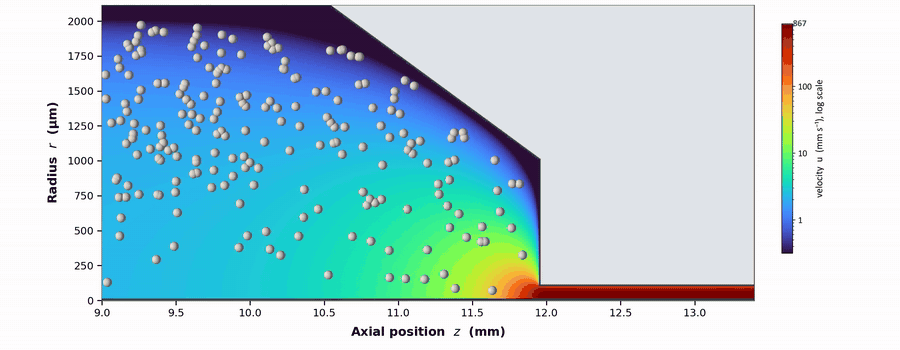

<h1 align="center">Fast computational screening of extrusion bioprinting</h1>

<p align="center">
  <b>Finite element model and Gaussian process surrogate for skeletal myoblasts in alginate hydrogel</b>
</p>

<p align="center">
  <a href="LICENSE"></a>
  <a href="requirements.txt"></a>
  <a href="Dockerfile"></a>
</p>

<p align="center">
  
  <br>
  <sub>Velocity magnitude and cells entering the nozzle, 200 µm nozzle at 200 kPa.</sub>
</p>

Code and data for the article:

> **Fast computational screening of extrusion parameters for bioprinting of skeletal myoblasts in alginate hydrogel**<br>
> Zahed Tavangari, Ali Maghami, Antonio Papangelo, Giada Graziana Genchi<br>
> *BMC Biomedical Materials Science* (submitted)

## Overview

- **Flow.** An axisymmetric finite element model (DOLFINx) of a shear-thinning L8 myoblast suspension in
  1.5% alginate, from the cartridge through the nozzle, with inertia.
- **Damage.** Predicted cell damage split into shear along the nozzle and extension at the nozzle entrance.
- **Surrogate.** Gaussian processes trained on 32 nozzle–pressure cases return flow rate and damage for any
  nozzle diameter (100–330 µm) and pressure (25–400 kPa) in under a millisecond, and draw the operating
  window: damage below 20% at a flow rate of at least 1 µL/s.

## Quick start

```bash
git clone https://github.com/tavangariz/l8-myoblast-bioprinting-fem.git
cd l8-myoblast-bioprinting-fem
pip install -r requirements.txt
python scripts/fig7_operating_window.py        # writes results/figures/
```

The figure and analysis scripts read the solved cases in `results/` and need no solver; they were run with
Python 3.13, NumPy 2.2, SciPy 1.15, scikit-learn 1.7, Matplotlib 3.10 and Gmsh 4.15. To re-run the finite
element campaign (about 1.5 h per case), use the DOLFINx image: `docker compose --profile fem up fem-sweep`.

## Reproducing the figures

| Figure | Script |
|---|---|
| Fig. 1 | `fig1_workflow.py` |
| Fig. 2 | `fig2_geometry.py` |
| Fig. 3 | `fig3_damage_vs_diameter.py` |
| Fig. 4 | `fig4_pressure_dependence.py` |
| Fig. 5 | `fig5_lagrangian_tracers.py` |
| Fig. 6 | `fig6_surrogate_surfaces.py` |
| Fig. 7 | `fig7_operating_window.py` |
| Fig. 8 | `fig8_contraction_flow.py` |
| Figs. S1–S3 | `figS1_blocked_holdouts.py`, `figS2_model_checks.py`, `figS3_interval_calibration.py` |

Table 1 and the numbers in the text come from `table1_comparison.py`, `matched_flow.py`, `inertia.py` and
`reference_condition.py`; the supplementary tables from `build_supplementary_tables.py`,
`surrogate_validation.py` and `evaluate_fem_checks.py`.

## Repository layout

```
scripts/              solver, damage law, surrogate and one script per figure
scripts/validation/   comparisons with published flow and damage data
results/fem/          the 32 solved cases, per-case solver output, reference-condition field
results/surrogate/    surrogate validation
```

## Citation

```bibtex
@article{tavangari2026bioprinting,
  title   = {Fast computational screening of extrusion parameters for bioprinting of skeletal myoblasts in alginate hydrogel},
  author  = {Tavangari, Zahed and Maghami, Ali and Papangelo, Antonio and Genchi, Giada Graziana},
  journal = {BMC Biomedical Materials Science},
  note    = {Submitted},
  year    = {2026}
}
```

## Funding

- Agenzia Spaziale Italiana (ASI), doctoral grant 2024-59-HH.0, CUP F93C24000580001 (Z.T.)
- European Union, Horizon Europe Marie Skłodowska-Curie Actions, Grant Agreement No. 101285102, REAL-ADHERE (A.M.)
- European Research Council, ERC-2021-STG, SURFACE, Project ID 101039198, CUP D95F22000430006 (A.P.)

*Views and opinions expressed are those of the authors only and do not necessarily reflect those of the European Union or the European Research Council. Neither the European Union nor the granting authority can be held responsible for them.*

We thank the ReCaS-Bari data center for access to and support with the computing infrastructure on which the finite element campaign was run.

## License

MIT, see [LICENSE](LICENSE).
