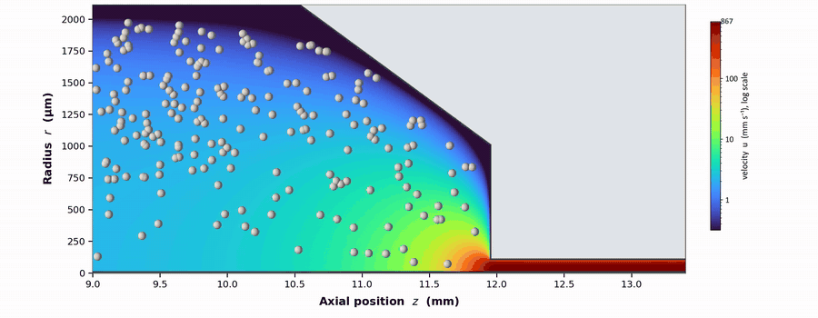

<h1 align="center">Computational screening of extrusion bioprinting</h1>

<p align="center">
  <b>Finite element model and Gaussian process surrogate for skeletal myoblasts in alginate hydrogel</b>
</p>

<p align="center">
  <a href="LICENSE"></a>
  <a href="requirements.txt"></a>
  <a href="Dockerfile"></a>
</p>

<p align="center">
  
  <br>
  <sub>Velocity magnitude and cells entering the nozzle, 200 µm nozzle at 200 kPa.</sub>
</p>

Code and data for the article:

> **Computational screening of nozzle diameter and applied pressure for extrusion bioprinting of L8 skeletal myoblasts in alginate hydrogel**<br>
> Zahed Tavangari, Ali Maghami, Antonio Papangelo, Giada Graziana Genchi<br>
> *BMC Biomedical Materials Science* (submitted)

## Overview

- **Flow.** An axisymmetric finite element model (DOLFINx) of a shear-thinning L8 myoblast suspension in
  1.5% alginate, from the cartridge through the nozzle, with inertia.
- **Damage.** Predicted cell damage split into shear along the nozzle and extension at the nozzle entrance,
  with a pressure-independent term fitted to the damage Ning *et al.* (2018) measured.
- **Surrogate.** Gaussian processes trained on 32 nozzle–pressure cases return flow rate and damage for any
  nozzle diameter (100–330 µm) and pressure (25–400 kPa) in under a millisecond, and draw the operating
  window: total damage below 20% at a flow rate of at least 1 µL/s.

## Quick start

```bash
git clone https://github.com/tavangariz/l8-myoblast-bioprinting-fem.git
cd l8-myoblast-bioprinting-fem
pip install -r requirements.txt
python scripts/fig7_operating_window.py        # writes results/figures/
```

The figure and analysis scripts read the solved cases in `results/` and need no solver; they were run with
Python 3.12 and 3.13, NumPy 2.2, SciPy 1.15, scikit-learn 1.7, Matplotlib 3.10 and Gmsh 4.15. To re-run the finite
element campaign (about 1.5 h per case), use the DOLFINx image: `docker compose --profile fem up fem-sweep`.

## Reproducing the figures

| Figure | Script |
|---|---|
| Fig. 1 | `fig1_workflow.py` |
| Fig. 2 | `fig2_geometry.py` |
| Fig. 3 | `fig3_damage_vs_diameter.py` |
| Fig. 4 | `fig4_pressure_dependence.py` |
| Fig. 5 | `fig5_lagrangian_tracers.py` |
| Fig. 6 | `fig6_surrogate_surfaces.py` |
| Fig. 7 | `fig7_operating_window.py` |
| Fig. 8 | `fig8_contraction_flow.py` |
| Additional file 1, Fig. S1 | `figS4_viscosity.py` |
| Additional file 1, Fig. S2 | `figS1_blocked_holdouts.py` |
| Additional file 1, Fig. S3 | `figS2_model_checks.py` |
| Additional file 1, Fig. S4 | `figS3_interval_calibration.py` |

Table 2 and the numbers in the text come from `table1_comparison.py`, `matched_flow.py`, `inertia.py` and
`reference_condition.py`; the supplementary tables from `build_supplementary_tables.py`,
`surrogate_validation.py`, `evaluate_fem_checks.py` and `evaluate_boundary_checks.py`.

## Analyses of Additional file 1

| Section | Script | Output in `results/analyses/` |
|---|---|---|
| S8 Calibration of the damage law against measured damage | `l8_calibration.py` | `calibration_variants.json` |
| S9 Robustness of the operating window | `window_analyses.py`, `boundary_sensitivity.py`, `extra_numbers.py`, `friction_accuracy.py` | `window_analyses.json`, `d0_uncertainty_boundary.json`, `measured_flow_operating_points.json`, `extra_numbers.json`, `friction_accuracy.json` |
| S10 Sensitivity of the tracer statistics | `tracking_sensitivity.py`, `tracking_convergence.py` | `tracking_sensitivity.json`, `tracking_tracers.csv`, `tracking_convergence.json` |
| S11 The surrogate against interpolants of the same data | `surrogate_benchmark.py`, `surrogate_benchmark_per_check.py`, `kernel_window_sensitivity.py` | `surrogate_benchmark.json`, `surrogate_benchmark_per_check.json`, `kernel_window_sensitivity.json` |
| S12 The entrance stress against the resolved flow | `entrance_proxy.py` | `entrance_proxy.json` |
| S13 The same pipeline for RSC96 Schwann cells | `rsc96_transfer.py` | `rsc96_transfer.json` |

The four FEM checks of the 20% limit on the total damage (Additional file 1, Table S12) were fixed by
`prespecify_boundary_checks.py` before any of them was solved. They are compared with the surrogate by
`evaluate_boundary_checks.py`. The script `entrance_proxy.py` reads two solved fields that are not distributed
for their size; its output is included. The values digitised from the figures of Ning *et al.* (2018) are in
`ning2018_data.py`. The bound on the effect of the upper viscosity limit (Additional file 1, Section S1) is
computed by `viscosity_cap.py` into `viscosity_cap.json`; the Bagley sweeps at the operating flow are in
`results/fem/runs/2026-11-04_bagley-operating`.

In `results/surrogate/fold_predictions.csv` the columns `Dt_fem_pct`, `Dt_pred_pct` and `Dt_sd_pp` keep the
names of release 1.0.0 and hold the condition-dependent damage Dn, the quantity the surrogate emulates. The
total damage Dt of the article follows from it by Eq. 25, Dt = D0 + (1 − D0) Dn, so an error on Dt is (1 − D0)
times the error on Dn.

The paths of the 168 tracers of Fig. 5 ship in `tracking_published_paths_cache.npz`, so the figure is redrawn
from the tracks of `tracking_tracers.csv`. Tracked again with 100-fold tighter integration tolerances, the
radii in the nozzle move by at most 0.005 µm and the shear damage of a tracer by at most 0.0003 percentage
points (`tracking_convergence.json`).

## Repository layout

```
scripts/              solver, damage law, surrogate and one script per figure
scripts/validation/   comparisons with published flow and damage data
results/fem/          the 32 solved cases, per-case solver output, reference-condition field
results/surrogate/    surrogate validation
results/analyses/     analyses of Additional file 1, caption numbers of Fig. 5
```

## Citation

```bibtex
@article{tavangari2026bioprinting,
  title   = {Computational screening of nozzle diameter and applied pressure for extrusion bioprinting of L8 skeletal myoblasts in alginate hydrogel},
  author  = {Tavangari, Zahed and Maghami, Ali and Papangelo, Antonio and Genchi, Giada Graziana},
  journal = {BMC Biomedical Materials Science},
  note    = {Submitted},
  year    = {2026}
}
```

## Funding

- Agenzia Spaziale Italiana (ASI), doctoral grant 2024-59-HH.0, CUP F93C24000580001 (Z.T.)
- European Union, Horizon Europe Marie Skłodowska-Curie Actions, Grant Agreement No. 101285102, REAL-ADHERE (A.M.)
- European Research Council, ERC-2021-STG, SURFACE, Project ID 101039198, CUP D95F22000430006 (A.P.)

*Views and opinions expressed are those of the authors only and do not necessarily reflect those of the European Union or the European Research Council. Neither the European Union nor the granting authority can be held responsible for them.*

We thank the ReCaS-Bari data center for access to and support with the computing infrastructure on which the finite element campaign was run.

## License

MIT, see [LICENSE](LICENSE).
